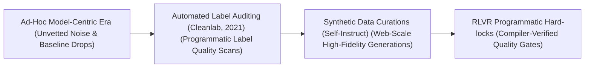
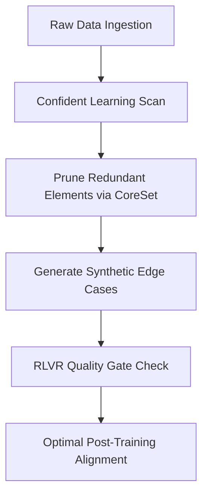

# Awesome-Data-Centric-AI
<!-- SEO Meta: Data-Centric AI, Machine Learning, MLOps, Confident Learning, Synthetic Data -->

 

## Data-Centric AI: History, Progression, Variants, & Applications

**Data-Centric AI** is an engineering and operational paradigm in artificial intelligence that treats data as the primary vector for system optimization. Popularized by Andrew Ng in 2021, Data-Centric AI shifts the core development focus away from continuously tweaking model architectures to holding the architecture fixed while systematically cleaning, curating, and augmenting the underlying dataset. 

In traditional **Model-Centric AI**, engineers treat the dataset as a static baseline and focus exclusively on engineering hyperparameter tunings, deep layer connections, or massive parameter capacities. Data-Centric AI flips this methodology, establishing that data quality dominates model size. By implementing programmatic label curation, error cleaning, targeted synthetic sampling, and data augmentation loops, Data-Centric AI builds highly accurate, robust, and aligned systems at a fraction of the hardware compute footprint required by bloated models.

---

## 🕰️ 1. The Macro Chronological Evolution

The technical framework governing AI dataset management has transitioned from unstructured ad-hoc crowdsourcing to automated data pipelines, web-scale synthetic curation, and native post-training alignment environments.

| Era | Details | Year | Paper | Link |
|---|---|---|---|---|
| The Ad-Hoc Model-Centric Era | **Concept:** The baseline development standard, relying on massive unvetted web-scrapes. **Limitation:** Intolerable optimization waste due to persistent hallucinations. | Pre-2021 | [N/A](#) | [Details](pages/ad-hoc.md) |
| The Programmatic Label Quality & Auditing Era | **Concept:** Automated engineering discipline using Confident Learning. **Significance:** Slashed label noise and data bloat. | 2021 | [Confident Learning](https://arxiv.org/abs/1911.00068) | [Details](pages/prog-label.md) |
| The Web-Scale High-Fidelity Synthetic Curation Era | **Concept:** Solved impending human data exhaustion crisis using Self-Instruct. **Significance:** Recursively mutates small vetted seeds into millions of pristine scenarios. | 2023 | [Self-Instruct](https://arxiv.org/abs/2212.10560) | [Details](pages/web-scale.md) |
| The Compiler-Locked Programmatic Verification Era | **Concept:** RLVR checking via hardcoded software environments. **Significance:** Zero-noise data loop enforced by compilers. | 2025 | [DeepSeek-R1](https://arxiv.org/abs/2501.12948) | [Details](pages/compiler-locked.md) |

---

## ⚙️ 2. Core Functional & Algorithmic Variants

Data-Centric AI methodologies are strictly categorized based on the exact automated mechanisms deployed to cleanse, augment, and audit the training data matrix.

| Variant | Mechanism | Year | Paper | Link |
|---|---|---|---|---|
| Confident Learning | Evaluates dataset validity by estimating joint distributions of noisy and true labels. | 2019 | [Confident Learning](https://arxiv.org/abs/1911.00068) | [Details](pages/confident-learning.md) |
| CoreSet Selection | Slashes dataset redundancy mathematically using clustering or gradient-matching fields. | 2020 | [DeepCore](https://arxiv.org/abs/2204.08477) | [Details](pages/coreset.md) |
| Generative Synthetic Augmentation | Uses deep generative models to rewrite or visually alter datasets on-the-fly. | 2022 | [GenAug](https://arxiv.org/abs/2302.07923) | [Details](pages/gen-aug.md) |
| Automated Feature Store | Infrastructure-level framework tailored for enterprise MLOps treating data features as reusable assets. | 2017 | [Michelangelo](https://arxiv.org/abs/1712.06246) | [Details](pages/feature-store.md) |

---

## 🧩 3. The Data-Centric AI Pipeline Matrix

To maintain absolute data quality across large-scale optimization loops, data-centric architectures coordinate continuous cleaning and alignment layers concurrently.

| Component | Profile | Year | Paper | Link |
|---|---|---|---|---|
| Process-Supervised Evaluation (PRMs) | Granular token step quality auditing. Value network checks every step dynamically. | 2023 | [PRMs](https://arxiv.org/abs/2305.20050) | [Details](pages/prm.md) |
| Vector Database Deduplication | Slashes data leakage and memorization traps via dense sentence encoders and high-dimensional geometric coordinates. | 2021 | [Deduplicating Training Data](https://arxiv.org/abs/2107.06499) | [Details](pages/vector-dedup.md) |

---

## 🏭 4. Production Engineering Challenges & Infrastructure Mitigations

Implementing large-scale data-centric pipelines across massive distributed high-performance computing clusters introduces severe data latency and alignment constraints.

| Challenge | Mitigation | Year | Paper | Link |
|---|---|---|---|---|
| Distributed Dataloader Load-Imbalance | GPU-Fused Batched Data Augmentations (like NVIDIA DALI) to execute formatting in VRAM. | 2018 | [NVIDIA DALI](#) | [Details](pages/dataloader.md) |
| Distribution Drift (Model Collapse) | Hardcoding strict External Software Verifiers (RLVR) into synthetic loops. | 2023 | [The Curse of Recursion](https://arxiv.org/abs/2305.17493) | [Details](pages/model-collapse.md) |

---

## 🚀 5. Frontier Real-World AI Industrial Applications

| Application | Details | Year | Paper | Link |
|---|---|---|---|---|
| Pre-Training Web-Scale Transformers | Guides cluster-wide dataset selection and token curation for LLMs like Llama and DeepSeek. | 2023 | [Llama](https://arxiv.org/abs/2302.13971) | [Details](pages/llama.md) |
| Autonomous Vehicle Edge Perception | Secures computer vision systems against volatile road conditions using diffusion models. | 2020 | [Waymo Open Dataset](https://arxiv.org/abs/1912.04838) | [Details](pages/av.md) |
| Enterprise Credit Scoring | Regulates financial models using automated confident learning and data re-weighting pipelines. | 2021 | [Fairness in ML](https://arxiv.org/abs/2105.02725) | [Details](pages/credit.md) |

---

## References
1. Northcutt, C., Jiang, L., & Chuang, I. (2021). Confident learning: Estimating joint distribution of noisy labels. *Journal of Artificial Intelligence Research*, 70, 1373-1411.
2. Ng, Andrew. (2021). MLOps: From model-centric to data-centric AI. *DeepLearning.AI Architecture Manifesto*.
3. Mazumder, M., et al. (2022). Dataperf: Benchmarking data-centric AI dataset quality metrics. *arXiv preprint arXiv:2207.10062*.
4. Gunasekar, J., et al. (2023). Textbooks are all you need: Curation of pristine synthetic datasets for small language models. *Microsoft Phi Technical Report*.
5. Wang, L., et al. (2024). Multi-task instruction fine-tuning via self-instruct generative data curation loops. *International Conference on Learning Representations (ICLR)* [INDEX: 18].
6. DeepSeek-AI. (2025). DeepSeek-R1: Incentivizing reasoning and verification capability in foundational language transformers via large-scale self-play reinforcement learning loops initialized via compiler-vetted synthetic datasets [INDEX: 17, 21].

---

To advance this documentation repository, dataset automation workspace, or MLOps architecture, consider exploring these adjacent development pathways:
* Build a **Python script using PyTorch and Cleanlab** illustrating how to load a custom dataset, run an out-of-sample forward pass, and compute automated confident learning matrices to flag label noise.
* Generate a **comprehensive Markdown table** explicitly comparing Model-Centric AI, Confident Learning Curation, CoreSet Data Pruning, Generative Synthetic Curation, and Compiler-Locked RLVR Data Verification across lifecycle entry junctions, computational training overhead costs, required human annotation budgets, and resistance to model collapse.
* Establish a **performance profiling notebook using Triton** to track the exact cluster-wide compute efficiency, communication-to-computation overlap ratios, and memory bus bandwidth compression achieved when routing token-balanced data-centric batches over distributed server nodes.

***

**Follow-Up Options Matrix:**

Before updating this repository workspace layout, let me know how you would like to proceed by choosing one of the options below:
* I can provide a **complete Python code boilerplate using PyTorch** demonstrating how to write an automated script that calculates an exact k-center CoreSet selection data pruning loop.
* I can generate a **Markdown matrix table** tracking the explicit dataset parsing boundaries, filtering thresholds, and synthetic token distribution scales utilized by leading foundation repositories to manage data-centric design.
* I can write a detailed technical explanation focusing on the **mathematics of Confident Learning noise estimation** and how joint distribution calculations govern label error isolation.

##  Star History

<a href="https://www.star-history.com/?repos=ishandutta2007%2FAwesome-Data-Centric-AI&type=date&legend=bottom-right">
<picture>
<source media="(prefers-color-scheme: dark)" srcset="https://api.star-history.com/chart?repos=ishandutta2007/Awesome-Data-Centric-AI&type=date&theme=dark&legend=bottom-right" />
<source media="(prefers-color-scheme: light)" srcset="https://api.star-history.com/chart?repos=ishandutta2007/Awesome-Data-Centric-AI&type=date&legend=bottom-right" />

</picture>
</a>

# Awesome-Data-Centric-AI

## Top Data-Centric AI Ecosystem

**Curated List of SaaS Products & Open-Source GitHub Projects**  

*Focused on Label Quality, Programmatic Labeling & Data Curation*  

**Last updated: October 2026**

This repository tracks notable **SaaS platforms** and **open-source projects** for **Data-Centric AI**. These tools enable teams to systematically improve training data quality—detecting label errors, curating datasets, and building programmatic labeling pipelines—rather than only tuning model architectures.

**Examples** include Snorkel Flow, Scale AI, Labelbox, Appen, CloudFactory, Prodigy, SuperAnnotate, Dataloop, Encord, and V7 (the category leaders).

**Open-source emphasis**: This section is heavily expanded with every major active project for automated data quality, label error detection, and open annotation infrastructure—ideal for ML engineers, data scientists, and organizations seeking transparent, vendor-independent data improvement.

Contributions welcome! Open a PR to add/update entries. Keep descriptions factual and link to official sites.

## Table of Contents

- [Sector Overview & Market Dynamics](#sector-overview--market-dynamics)

- [SaaS/Hosted Platforms](#saas-hosted-platforms)

- [Open-Source GitHub Projects](#open-source-github-projects)

- [How to Contribute](#how-to-contribute)

- [Disclaimer](#disclaimer)

## Sector Overview & Market Dynamics

The global data-centric AI and data annotation & labeling market is estimated between **$2.1B and $6.3B in 2026** (scaling to **$9.3B–$17.1B by 2030** at an estimated **23%–28% CAGR**), catalyzed by generative AI, LLM alignment, and multimodal training demands. The sector is **moderately fragmented yet increasingly concentrated at the top**, with mega-infrastructure titans (e.g., Scale AI, Snorkel AI) capturing outsized enterprise budgets while specialized tooling platforms compete in niche multimodal, physical AI, and programmatic niches.

## SaaS/Hosted Platforms

| Platform | Valuation / Revenue (Scale) | Starting Pricing Tier | Free Tier Limits / Trial Limits | Key Capabilities & Highlights |
|---|---|---|---|---|
| **[Scale AI](https://scale.com/)** | **$29.0B** valuation *(Meta round, 2025)* | Custom enterprise contracts; self-serve tasks from **~$0.08–$0.12/item** or usage-based tiering | **Free Tier** via Nucleus for academia/independents (core visualization & dataset insights; self-serve low-volume trial credits) | High-leverage data platform; Scale Pro labeling with dedicated SLAs, Nucleus data curation/failure debugging, enterprise Gen AI platform. |
| **[Snorkel AI](https://snorkel.ai/)** | **$3.5B** valuation *(Series E, 2026; $375M ARR)* | Enterprise contracts starting upwards of **~$50,000–$60,000/year** | **No public free tier** (custom guided proof-of-concept / evaluation demos available upon request) | Programmatic AI data development platform; write code/heuristics instead of manual labeling, AKS native, SOC 2 Type II/HIPAA. |
| **[Labelbox](https://labelbox.com/)** | **$1.25B** valuation *(Series E, 2026)* | **$0.10/LBU** (Starter tier; consumption-based pay-as-you-go) | **500 LBUs/month free forever**, up to 30 users, 50 projects, 25 ontologies (1,500 API req/min) | Data factory for generative AI; Alignerr expert labeling community, Horizon RL environments, autonomous Recursion Managed Agents. |
| **[Encord](https://encord.com/)** | **$550M** valuation *(Series C, 2026)* | Custom quote-based (Starter/Team/Enterprise packaging) | **Starter Free Tier** for individual developers/prototyping (limited to small project workspaces and base annotator workflows) | Multimodal AI data platform; specialized in physical AI, computer vision, video, audio, and DICOM with embedding-based Index search. |
| **[CloudFactory](https://www.cloudfactory.com/)** | **$250M–$500M** valuation *(Dealroom estimates)* | Custom project contracts (piece-rate from **~$0.05+/label** or hourly from **~$8–$15/hr**) | **No free tier** (offers a complimentary data sample analysis/pilot review on client-submitted test batches) | Full-stack AI operations platform (Data, Training, Inference, and AI orchestration engines) targeting high-stakes reliability sectors. |
| **[Appen](https://www.appen.com/)** | **~$185M–$265M** market cap *(ASX: APX; ~$250M–$275M AUD)* | Custom enterprise quotes / Statements of Work (SOWs) | **No self-serve free trial** (enterprise custom PoCs/pilot phases negotiated via sales) | Veteran large-scale workforce labeling provider; text, audio, image, 3D/4D annotation, GDPR/SOC/HIPAA/ISO certified. |
| **[SuperAnnotate](https://www.superannotate.com/)** | **~$75M–$99M** total funding *(~$27M–$35M ARR estimate)* | Paid plans starting at **~$62/user/month** (Starter/Pro tiers) | **Free Plan** for small teams/evaluations (up to 3–5 seats and 1,000 compute pipeline orchestration hours) | Multimodal dataset creation platform; native Query Language (Explore), Vertex AI integration, automated pre-annotations. |
| **[Dataloop](https://dataloop.ai/)** | **$120M** acquisition valuation *(Acquired by Dell, 2025)* | Custom enterprise contracts | **No self-serve free plan** (evaluation PoC environments available via guided sales demo/expert consultation) | Agentic AI data orchestration platform; deep Databricks Unity Catalog, NVIDIA NIM/NeMo, and VLM agent integrations. |
| **[V7](https://www.v7labs.com/)** | **~$100M** valuation *(~$27.7M ARR estimate)* | Starter paid tier starting at **~$499/month** (or ~$5,400/yr) | **Basic Free Plan ($0)** (restricted to 1 workspace, up to 10 user seats, and 100 files/items limit) | AI data labeling suite; 10x speedup with AI auto-annotation, multi-stage review workflows, specialized DICOM/PDF support. |
| **[Prodigy](https://prodigy.ai/)** | **Bootstrapped** *(Explosion AI, ~$1.4M ARR estimate)* | **$490/seat** (one-time perpetual lifetime license, packs of 5) | **No self-serve free trial software download** (full interactive browser demos online; free academic research licenses on application) | Scriptable, privacy-first local annotation tool from makers of spaCy; zero data leaves your infrastructure, active learning loops. |

## Open-Source GitHub Projects

- **[cleanlab](https://github.com/cleanlab/cleanlab)**  

  **Standard data-centric AI package for data quality and machine learning with messy data** (AGPL-3.0 for open-source) . **The most widely adopted open-source data-centric AI library**—**automatically detects data and label issues** in ML datasets using model outputs (predicted probabilities or embeddings) . **Found thousands of label errors in ImageNet, MNIST, and other benchmarks** . **Core capabilities**: **`CleanLearning.find_label_issues`** (works with any scikit-learn compatible model—pass untrained model, data, and labels), **`dataset.health_summary()`** (one-line dataset-level health check), **outlier/OOD detection**, **multi-annotator consensus**, and **active learning** . **Supports multi-label, sequence prediction, and crowdsourced data** . **The reference implementation for automated label quality assessment** .

- **[Cleanlab Studio](https://cleanlab.ai/studio/)**  

  **Client interface for Cleanlab Studio** (open-source client, commercial platform) . **Detects label errors, outliers, and data issues at scale**—the managed version of the cleanlab library for teams wanting automated data quality without infrastructure management.

- **[Label Studio](https://github.com/HumanSignal/label-studio)**  

  **The most flexible open-source data labeling tool** (Apache-2.0) . **20,000+ GitHub stars** . Supports **text, vision, audio, and time-series data** with custom XML UI templates, ML backend integrations, and webhook integrations . **The foundation for most open-source annotation workflows**—covers both small-model (CV/NLP/audio) and large-model (RLHF, dialogue ranking, LLM evaluation) scenarios.

- **[CVAT](https://github.com/cvat-ai/cvat)**  

  **Computer Vision Annotation Tool** (MIT) . **14,000+ GitHub stars** . **The industrial-grade benchmark for image and video annotation**—features **SAM3 and YOLO auto pre-labelling**, multi-level quality inspection, annotation time tracking, native S3/object storage, and 20+ export formats (COCO, YOLO, KITTI, MOT) . Helm for large-scale K8s cluster deployment .

- **[Argilla](https://github.com/argilla-io/argilla)**  

  **Human-in-the-loop annotation for LLM prompt-response evaluation and RLHF** (Apache-2.0) . **The standard open-source tool for LLM evaluation data curation**—purpose-built for preference data with HuggingFace integration.

- **[Knowlyr Datalabel](https://pypi.org/project/knowlyr-datalabel/)**  

  **Offline-first, zero-dependency annotation platform generating standalone HTML interfaces** (PyPI) . Features **5 annotation types**, **multi-annotator merge with IAA computation** (Cohen's/Fleiss' Kappa, Krippendorff's Alpha), **LLM-powered pre-labelling and quality analysis**, and **MCP support** for Claude Desktop/Code integration . **The most feature-complete lightweight open-source annotation quality tool** .

### Additional Strong Open-Source Options

- **[cleanlab](https://github.com/cleanlab/cleanlab)** — See above. **The only major open-source library specifically targeting automated label error detection** .

- **[FiftyOne](https://github.com/voxel51/fiftyone)** — Open-source tool for curating high-quality datasets and refining visual AI models (Apache-2.0) . **Dataset visualization, model evaluation, and embedding analysis** .

- **[Xtreme1](https://github.com/xtreme1-io/xtreme1)** — All-in-one data labeling and annotation platform for multimodal data (Apache-2.0, LF AI & Data Foundation project) . **3D LiDAR, image, and LLM (RLHF beta)** support .

- **[clean-evals](https://pypi.org/project/clean-evals/)** — Open-source eval platform with **blind review, golden answer locking, and LLM judge calibration** .

- Community **n8n** workflows for data quality alerting and annotation pipeline automation.

**Frameworks for building custom systems**: Combine **cleanlab** for automated label error detection with **Label Studio** or **CVAT** for annotation, **FiftyOne** for dataset curation and visualization, **Argilla** for LLM evaluation data, and **Cleanlab Studio** for managed data quality at scale—creating a comprehensive data-centric AI stack.

## How to Contribute

1. Fork the repo.

2. Add/edit entries in `README.md` (follow existing format).

3. Include: name, link, 1–2 sentence description, and whether it's SaaS or open-source.

4. Submit PR with a short explanation.

Star the repo if you find it useful!

## Disclaimer

- This is a **community-curated** list — not exhaustive and not an endorsement.

- Data-centric AI tools handling training data must comply with data protection regulations (GDPR, CCPA, etc.) and ensure annotation workforce agreements are in place.

- **Open-source data-centric AI is mature for label quality but limited for enterprise curation.** **cleanlab** is the **only major open-source library specifically targeting automated label error detection**—it found thousands of errors in ImageNet and MNIST . **But no open-source tool provides the end-to-end programmatic labeling, RL environment generation, or managed workforce of Snorkel Flow, Scale AI, or Labelbox** . **Integration work is required.**

- **The "data-centric" distinction matters.** Model-centric AI focuses on architecture and hyperparameters. **Data-centric AI focuses on systematically improving the data**—finding label errors, curating diverse examples, and building programmatic labeling functions . **cleanlab's approach is unique**: it uses **model outputs (predicted probabilities or embeddings)** to detect issues—**it works with any model, not just a specific architecture** .

- **Label error detection is the highest-leverage data improvement.** **cleanlab found thousands of label errors in ImageNet, MNIST, and other popular benchmarks** . **If your benchmark datasets have errors, your production data almost certainly does too** . **Run `cleanlab.dataset.health_summary()` before assuming your model architecture is the problem** .

- **The commercial landscape has evolved beyond labeling.** **Scale AI** moved from pure labeling to **full-stack AI infrastructure** (valued at $29B+) . **Labelbox** built **RL environments (Horizon) and autonomous agents (Recursion)**—used by 90%+ of leading US AI labs . **Snorkel Flow** provides **programmatic labeling** that accelerates data development 10-100x . **The category is no longer just "data labeling"—it's data development infrastructure.**

- Self-hosted open-source solutions require proper annotation workforce management, data storage, and ongoing maintenance. **Training data is a strategic asset**—access controls and versioning are essential.

---

**Made for ML engineers, data scientists, and organizations building transparent data-centric AI solutions.**  

Let's make Data-Centric AI more open, data-driven, and quality-obsessed.
